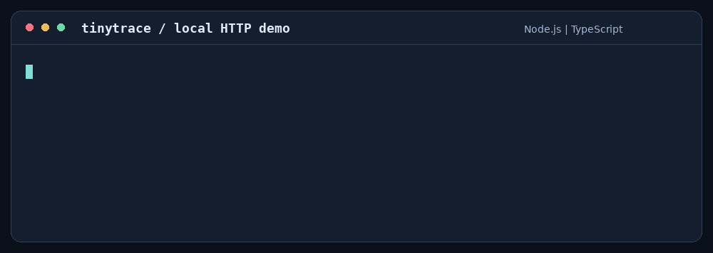

<div align="center">

# tinytrace

**Capture errors. Keep context private. Carry events through outages.**

A zero-runtime-dependency TypeScript error-tracking SDK for Node.js and browsers.

[](https://www.npmjs.com/package/@garvj65/tinytrace)
[](https://github.com/garvj65/tinytrace/actions/workflows/ci.yml)


[](LICENSE)

[Install](#install) · [Durable delivery](#durable-delivery) · [Request isolation](#request-isolation) · [Browser](#browser) · [API reference](docs/SDK.md)

</div>

## Why this project exists

A monitoring SDK runs inside someone else's application. It has to collect useful context, contain its own failures, protect sensitive data, and deliver events over an unreliable network.

**tinytrace demonstrates that engineering problem in a readable, self-contained project.** Version 1 completed the capture-to-ingest loop in 789 handwritten lines. Version 2 adds operational SDK features: bounded persistent outboxes, isolated scopes, application-specific redaction, browser capture, framework integration, source maps, spans, and a Sentry envelope adapter.

The project ends at the SDK boundary. Its included ingest server remains a loopback demonstration, with in-memory grouping and deduplication. Hosting a shared monitoring service, storing server-side history, dashboards, and alerting are outside this release.

## What v2 includes

| Area | Capability |
| --- | --- |
| **Capture** | Exceptions, messages, Node fatal handlers, and browser error/rejection listeners. |
| **Delivery** | Batching, finite backoff cycles, Retry-After, deadlines, stable IDs, and optional persistent outboxes. |
| **Persistence** | Private atomic files on Node; IndexedDB with exclusive tab ownership in browsers. |
| **Context** | AsyncLocalStorage scopes on Node; explicit scoped clients in browsers. |
| **Privacy** | Default secret/PII patterns plus literal values, sensitive keys, field paths, and tag allowlists. |
| **Frameworks** | Tested Express 5 request/error middleware and a native Node HTTP wrapper. |
| **Source maps** | Explicitly registered flat Source Map v3 mappings; no automatic network/file retrieval. |
| **Performance** | Nested async spans, request durations, error correlation, and transaction sampling. |
| **Sentry** | Public-DSN routing and envelopes for errors, messages, and basic transactions. |
| **Packaging** | ESM and CommonJS share one Node client; a separate browser-safe ESM entry. |

## Tech stack

| Layer | Technology | Reason |
| --- | --- | --- |
| Language | **TypeScript 5.9** | Strict checking and generated declarations. |
| Node runtime | **Node.js 22+ · ESM + CommonJS** | Native HTTP, filesystem, crypto, and async context. |
| Browser runtime | **Fetch · Web Crypto · IndexedDB · Web Locks** | Browser capture and optional persistent delivery without a runtime package. |
| Tests | **node:test · Playwright · Express 5** | Real HTTP, killed processes, package consumers, and Chromium reloads. |
| Automation | **GitHub Actions · Gitleaks · CodeQL · npm audit** | Cross-platform regressions, secrets, static analysis, and dependency integrity. |

All installed dependencies are development tools or test fixtures. **The published SDK has zero runtime dependencies.**

## Install

```sh
npm install @garvj65/tinytrace
```

```js
import { init, captureException, setTag, addBreadcrumb, close } from '@garvj65/tinytrace';
// CommonJS: const { init, captureException, close } = require('@garvj65/tinytrace');

init({ endpoint: 'http://127.0.0.1:4318/events', environment: 'development' });
setTag('service', 'checkout');
addBreadcrumb({ category: 'payment', message: 'Payment requested' });
captureException(new Error('Payment provider unavailable'));
console.log('Delivered:', await close(2000));
```

Start the included server from a source checkout with `npm run ingest`.

## Durable delivery

```js
import { init, captureExceptionAsync, getStats, close } from '@garvj65/tinytrace';

init({
  endpoint: 'http://127.0.0.1:4318/events',
  durable: { directory: './private-tinytrace-outbox', maxEvents: 1000, maxBytes: 16 * 1024 * 1024 }
});
const id = await captureExceptionAsync(new Error('Provider offline'));
console.log('Persisted:', id, getStats());
await close(2000);
```

Persistent mode writes sanitized events before sending, retains transient failures after a retry cycle, and replays them on the next initialization. A successful HTTP response acknowledges and removes an event. Permanent HTTP rejections are dropped and counted.

`captureException()` returns an ID after acceptance into the bounded write queue. **With persistent mode enabled, `captureExceptionAsync()` or `await persist()` is the persistence barrier.** A hard kill before that barrier can still lose an event. Filesystem/device failures, browser eviction, exhausted capacity, retention expiry, and permanent server rejection can also lose data. A crash after acceptance but before local acknowledgement can cause a duplicate; stable IDs let the receiver deduplicate.

Use a private directory on a persistent local volume, unique to one live SDK instance on one machine. The outbox binds itself to its destination and rejects another live owner or destination. Linux/macOS writes sync file data and directory entries; Node's portable APIs cannot sync directory entries on Windows. Browser durability requires IndexedDB, Web Crypto, and Web Locks on a secure origin. Storage failures are observable through `getStats()` and fail closed.

## Request isolation

```js
import { withScope, setTag, addBreadcrumb, captureException } from '@garvj65/tinytrace';

await withScope(async () => {
  setTag('request_id', 'generated-request-id');
  addBreadcrumb('Inventory checked');
  await processOrder();
  captureException(new Error('Order failed'));
});
```

Global context provides the baseline. Each scope snapshots it and isolates later changes across async work. Nested scopes inherit their parent's context.

For Express 5, register request middleware before routes and error middleware afterward:

```js
import { requestHandler, errorHandler } from '@garvj65/tinytrace/integrations';
app.use(requestHandler());
// Register your routes here.
app.use(errorHandler());
// Register your application's response/error handler last.
```

Middleware creates a request scope and duration span, captures errors, and forwards them to Express. It records the method and status code; it does not collect request URLs, headers, cookies, or bodies. Native HTTP applications can use `httpHandler(handler)` from the same entry.

## Application-specific privacy

```js
init({
  endpoint: 'https://your-ingest.example/events',
  redaction: {
    keys: ['customer_id', 'claim_number'],
    values: ['internal-customer-reference'],
    paths: ['breadcrumbs.*.message'],
    allowTags: ['service', 'deployment', 'customer_id']
  },
  beforeSend(event) {
    return event.message.includes('ignore-me') ? null : event;
  }
});
```

Custom values are literal strings, avoiding user-supplied regular-expression execution. Rules apply after hooks and validation and before persistence or delivery. Recognized credentials, emails, private keys, authentication values, and home-directory usernames are redacted by default. Unknown hook fields are stripped. `redactEvent(event, rules)` exposes the helper.

These safeguards do not identify every possible secret or personal-data format. Hooks receive original input and must avoid logging it. Outbox files are plaintext and rely on host storage permissions; use domain-specific rules and encrypted storage when required.

## Browser

```js
import * as trace from '@garvj65/tinytrace/browser';
trace.init({
  endpoint: 'https://your-ingest.example/events',
  durable: { database: 'my-app-tinytrace' }
});
await trace.withScope(async scope => {
  scope.setTag('operation', 'checkout');
  await submitOrder();
  scope.captureMessage('Order submitted');
});
```

Use the supplied `scope` inside async browser work. Browser global setters intentionally remain global; they do not provide ambient async isolation. Automatic window errors and unhandled rejections are captured without suppressing the browser's handling. Persistent outboxes have one active tab owner; use distinct database names for independent simultaneous clients. Your ingest endpoint must allow the application's origin through CORS. The included CLI server does not enable cross-origin access.

The browser suite runs in real Chromium. Other browsers must provide the APIs listed above and are not part of the verified compatibility matrix.

## Spans, source maps, and Sentry

```js
import { startSpan, registerSourceMap } from '@garvj65/tinytrace';
registerSourceMap('https://app.example/bundle.js', sourceMapJson);
await startSpan({ name: 'checkout', op: 'task' }, async scope => {
  await scope.startSpan({ name: 'inventory lookup', op: 'db.query' }, async () => lookupInventory());
});
```

Spans measure async work, correlate captured errors, preserve callback return values/rejections, and produce bounded transaction events. `tracesSampleRate` is independent of error sampling; `beforeSendTransaction` is the transaction hook. The SDK does not automatically instrument outgoing requests or propagate distributed tracing headers.

Register source maps explicitly using the generated filename that appears in the stack. Only flat v3 mappings are supported; indexed maps and automatic artifact discovery are outside this release. Node can also use its native `--enable-source-maps` stack support.

To send supported events as Sentry envelopes, initialize with `dsn: 'https://PUBLIC_KEY@YOUR_INGEST_HOST/PROJECT_ID'` instead of `endpoint`. The adapter's error, message, and transaction payloads are contract-tested against a local receiver using the current published protocol. A live Sentry account was not used for validation. Sessions, attachments, profiling, and complete Sentry SDK feature parity are outside scope. See the [protocol references](docs/SDK.md#protocol-references).

## Demo and verification

```sh
git clone https://github.com/garvj65/tinytrace.git
cd tinytrace
npm ci
npm run check
npx playwright install chromium
npm run test:browser
npm run demo
```



| Command | Verification |
| --- | --- |
| `npm test` | Unit, real HTTP, hard-kill recovery, scopes, middleware, source maps, spans, and envelopes. |
| `npm run verify:package` | Install the tarball without dev dependencies; test HTTP, ESM/CJS identity, and Node/browser declarations. |
| `npm run test:browser` | Real Chromium capture, scopes, privacy, spans, IndexedDB reloads, tab ownership, and envelope delivery. |
| `npm run check` | Node regressions, size guard, local demo, and clean package consumers. |
| `npm run verify:registry` | Wait for registry propagation and compare published integrity with the locally rebuilt tarball. |

CI tests Linux Node 22/24/26 and Windows Node 24, plus Chromium, full-history secret scanning, CodeQL security-extended queries, npm advisories, and registry signatures. The expanded v2 has a runtime budget below 1800 lines and total code budget below 3500 lines; the original sub-800-line milestone applies to v1.

[SDK reference](docs/SDK.md) · [Validation and limits](docs/VALIDATION.md) · [Release guide](RELEASING.md) · [Changelog](CHANGELOG.md) · [Security](SECURITY.md)

**License:** [MIT](LICENSE) · **Author:** [Garv Jhajharia](https://github.com/garvj65)

<sub>An independent educational project, unaffiliated with Sentry.</sub>
