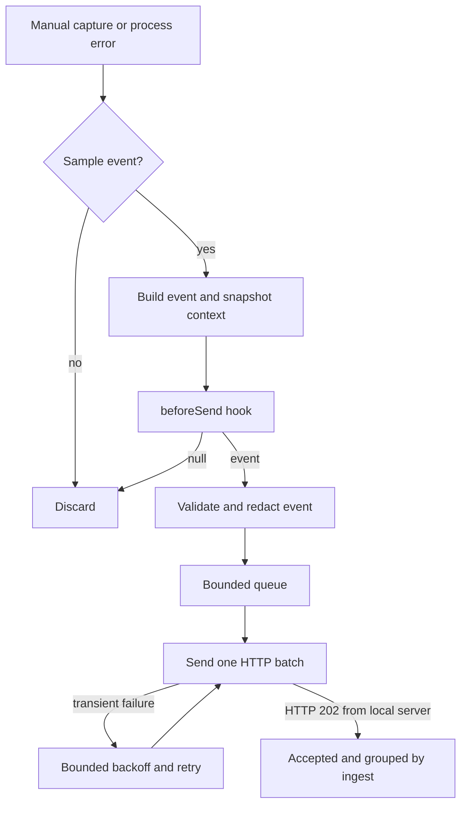

<div align="center">

# tinytrace

**Capture errors. Carry context. Deliver quietly.**

A miniature error-tracking SDK for Node.js, built in TypeScript with zero runtime dependencies.

[](https://github.com/garvj65/tinytrace/actions/workflows/ci.yml)


[](LICENSE)

[Quick start](#quick-start) · [How it works](#how-it-works) · [SDK reference](docs/SDK.md) · [Release guide](RELEASING.md)

</div>

## Why this project exists

Monitoring SDKs run inside someone else's application. They need to capture enough context to explain a failure, deliver it across an unreliable network, and contain their own failures along the way.

**tinytrace explores that engineering problem in a small, readable codebase.** It follows an error from capture through stack parsing, contextual enrichment, filtering, batching, retry, and local ingestion. A tiny HTTP server completes the loop by deduplicating events and grouping recurring errors by fingerprint.

The objective is to understand and demonstrate how an error-tracking SDK is designed: its public API, lifecycle, transport, failure behavior, and tradeoffs. The initial implementation, tests, and demo fit within **789 handwritten lines**, including validation scripts.

## What it does

| Capability | Implementation |
| --- | --- |
| **Capture** | Manual exceptions and messages, plus automatic `uncaughtException` and `unhandledRejection` capture. |
| **Context** | Parsed V8 stack frames, environment labels, tags, and a rolling breadcrumb history. |
| **Control** | Per-event sampling, a synchronous `beforeSend` hook, schema validation, and default event redaction. |
| **Delivery** | Bounded batching queue, one request at a time, request deadlines, and finite retries with exponential backoff and jitter. |
| **Ingestion** | Local HTTP endpoint, stable event IDs, bounded deduplication, and fingerprint-based grouping. |
| **Lifecycle** | Explicit `flush()` and `close()`, listener cleanup, and a bounded fatal-error delivery attempt. |

## Tech stack

| Layer | Technology | Purpose |
| --- | --- | --- |
| Language | **TypeScript 5.9** | Strict types, checked module boundaries, generated declarations. |
| Runtime | **Node.js 22+ · ESM** | Native process hooks and asynchronous I/O. |
| Transport | **`node:http` · `node:https`** | HTTP delivery without a third-party client. |
| Event identity | **`node:crypto`** | Random event IDs and SHA-256 fingerprints. |
| Tests | **`node:test` · `node:assert`** | Unit, HTTP integration, and child-process lifecycle tests. |
| Automation | **GitHub Actions** | Linux Node 22/24/26, Windows Node 24, package-consumer tests, Gitleaks, CodeQL, and npm security checks. |
| Packaging | **npm · `tsc`** | Compiled JavaScript and TypeScript declarations. |

**Runtime dependencies: 0.** TypeScript and Node typings are development dependencies only.

## Quick start

You need **Node.js 22 or newer**, npm, and Git. No API keys, database, account, or `.env` file is needed for the local demo.

```sh
git clone https://github.com/garvj65/tinytrace.git
cd tinytrace
npm ci
npm test
npm run demo
```

The demo starts a loopback server on an available port, captures the same checkout error twice and one message, flushes the SDK, and shuts everything down.


```text
Delivered: true | Groups: 2 | Events: 3
```

## Use the SDK locally

Start the standalone ingest server:

```sh
npm run ingest
```

It listens at `http://127.0.0.1:4318/events`. In another terminal, save the following as `app.mjs` in the repository root and run `node app.mjs`:

```js
import {
  init, captureException, captureMessage,
  setTag, addBreadcrumb, close
} from './dist/index.js';

init({
  endpoint: 'http://127.0.0.1:4318/events',
  environment: 'development',
  sampleRate: 1,
  beforeSend(event) {
    if (event.message.includes('ignore-me')) return null;
    delete event.tags.email;
    return event;
  }
});

setTag('service', 'checkout');
addBreadcrumb({ category: 'cart', message: 'Clicked Pay' });

try {
  throw new TypeError('Payment provider unavailable');
} catch (error) {
  const eventId = captureException(error);
  console.log('Queued event:', eventId);
}

captureMessage('Checkout attempt finished');
console.log('Delivered:', await close(2000));
```

An event ID confirms the event was queued. Use `await flush()` or `await close()` when a short-lived script needs to wait for delivery. Full API contracts, options, defaults, and limits are in the [SDK reference](docs/SDK.md).

## How it works



The server counts each event ID once within its bounded deduplication window. Fingerprints combine error type, message, and filename/function pairs so repeated errors can be grouped without depending on their line numbers.

### The reliability decisions

- **Bound memory:** the default queue holds 100 events, including the active batch. Overflow drops the newest incoming event; each serialized event is limited to 16 KiB.
- **Bound delivery work:** batches contain up to 20 events by default, with a 2-second request deadline and three retries after the initial attempt. A `Retry-After` beyond the configured wait budget stops retrying rather than sending early. Network errors, HTTP 408/429, and 5xx responses retry; other non-2xx responses drop immediately.
- **Keep background work unobtrusive:** networking is asynchronous, and background timers/sockets do not keep a healthy process alive. Event building, serialization, and the synchronous user hook still consume CPU on the caller's thread.
- **Make shutdown explicit:** with no other relevant host handler, a fatal error gets a delivery attempt of at most 2 seconds before exiting with code 1. Host handlers registered before or after initialization retain shutdown ownership, including one-shot and prepended handlers. Once delegated, ownership stays with the host until reinitialization; removing its handler does not transfer lifecycle control back to the SDK. Set `globalHandlers: false` when a framework manages this lifecycle.
- **Report delivery limits honestly:** this is an in-memory, best-effort transport. Exhausted retries, overflow, hard crashes, or abrupt exits can lose events. `flush()` returns `false` on a deadline or any transport-level loss since initialization.

## Privacy defaults

After `beforeSend`, tinytrace snapshots and validates the event, strips unknown fields, and redacts recognized credentials, bearer/basic authentication, private-key blocks, provider tokens, sensitive tag keys, email addresses, URL passwords, and home-directory usernames. It also recomputes the fingerprint from sanitized fields. Fatal SDK diagnostics contain no original error text.

`redactEvent(event)` exposes the same helper and returns `null` for an invalid event. Automatic redaction is enabled by default; `redact: false` explicitly disables it. The hook receives the original event, so hook code itself must avoid logging sensitive input.

These are pattern-based safeguards, not a guarantee that arbitrary personal data is detected. Add domain-specific filtering in `beforeSend`. Tags and breadcrumbs are process-wide; request isolation is outside v1.

## Project map

| Path | Responsibility |
| --- | --- |
| [`src/index.ts`](https://github.com/garvj65/tinytrace/blob/main/src/index.ts) | Public API, context, global handlers, and client lifecycle. |
| [`src/event.ts`](https://github.com/garvj65/tinytrace/blob/main/src/event.ts) | Event building, stack parsing, IDs, and fingerprints. |
| [`src/privacy.ts`](https://github.com/garvj65/tinytrace/blob/main/src/privacy.ts) | Hook-output validation, schema snapshots, and default redaction. |
| [`src/transport.ts`](https://github.com/garvj65/tinytrace/blob/main/src/transport.ts) | Queue, batching, HTTP requests, retry, and deadlines. |
| [`src/server.ts`](https://github.com/garvj65/tinytrace/blob/main/src/server.ts) | Standalone loopback ingest server and grouping. |
| [`src/types.ts`](https://github.com/garvj65/tinytrace/blob/main/src/types.ts) | Event schema, options, and shared bounds. |
| [`test/`](https://github.com/garvj65/tinytrace/tree/main/test) | Unit, integration, and fatal-error child-process tests. |
| [`examples/demo.mjs`](https://github.com/garvj65/tinytrace/blob/main/examples/demo.mjs) | Self-contained SDK-to-ingest demonstration. |
| [`.github/workflows/ci.yml`](https://github.com/garvj65/tinytrace/blob/main/.github/workflows/ci.yml) | Node version matrix and automated verification. |
| [`docs/SDK.md`](docs/SDK.md) | API reference and design details. |

## Development and verification

| Command | Purpose |
| --- | --- |
| `npm run build` | Compile TypeScript into `dist/` with declarations. |
| `npm test` | Build and run the 39-test regression suite. |
| `npm run check` | Tests, code-size guard, demo, and clean-consumer package/type checks. |
| `npm run verify:package` | Install the packed tarball and exercise its HTTP API and declarations. |
| `npm run demo` | Run the complete local capture-to-ingest flow. |
| `npm run ingest` | Start the standalone ingest server on port 4318. |
| `npm pack --dry-run` | Build and inspect the npm package contents. |

The tests exercise context snapshots, stack parsing, sampling, hook failures, redaction across event fields, malformed payload rejection, retry budgets, real HTTP retry hints, queue overflow, hanging/refused connections, ingest validation, deduplication, and process shutdown. Lifecycle cases cover persistent, one-shot, and prepended host handlers before and after initialization, strict rejection mode, actual in-flight requests, bounded shutdown time, and repeated listener cleanup. Fatal cases run in child processes, including strict unhandled-rejection mode and applications with their own process handlers.

See the [CI runs](https://github.com/garvj65/tinytrace/actions) and [validation notes](docs/VALIDATION.md) for verification details. Generated build output, `node_modules`, and package tarballs are excluded from Git; `npm run build` and `npm pack` reproduce them.

## Scope and release status

The v1 code includes the core SDK, transport, local ingest server, privacy and lifecycle hardening, regression tests, package-consumer checks, demo, documentation, and automated security gates. The configured package name is **`@garvj65/tinytrace`**. The [release workflow](.github/workflows/publish.yml) publishes after trusted main-branch CI succeeds and verifies the registry tarball integrity. Publication is complete only when `npm run verify:registry` confirms the released artifact. Run from source or install a locally generated tarball until then. See the [release guide](RELEASING.md), [changelog](CHANGELOG.md), and [security scope](SECURITY.md).

Source maps, a UI, performance monitoring, framework adapters, and durable storage are outside the initial scope. A Sentry-compatible envelope adapter is a possible extension; the current local ingest format is not Sentry-compatible.

**License:** [MIT](LICENSE) · **Author:** [Garv Jhajharia](https://github.com/garvj65)

<sub>An independent educational project, unaffiliated with Sentry.</sub>
