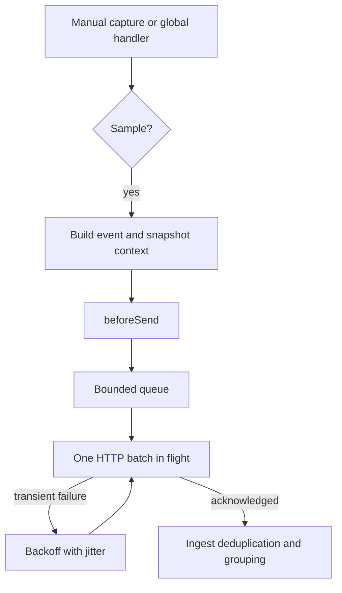

# SDK reference

[← Project overview](../README.md)

## API

| Function | Behavior |
| --- | --- |
| `init(options)` | Installs a singleton client. Reinitialization discards the previous queue and removes its handlers; call `await close()` first to retain delivery. Invalid setup is ignored. |
| `captureException(unknown)` | Returns a queued event ID, or `undefined` when skipped/dropped. Handles Errors, primitives, and throwing property access. An ID means queued, not delivered. |
| `captureMessage(string)` | Captures an informational event; same return contract. |
| `setTag(key, value)` | Sets a string tag for future events. Maximum 32 keys, 128 characters/key, 256/value. |
| `addBreadcrumb(string \| { message, category? })` | Keeps the most recent 20 entries, with timestamps. Messages are capped at 512 characters; categories at 128. |
| `await flush(timeoutMs = 2000)` | Starts delivery immediately; waits for an empty queue or the deadline. Returns `false` if the deadline expires **or this client has ever dropped an event at transport level**. A timed-out flush leaves background work running. |
| `await close(timeoutMs = 2000)` | Detaches handlers, stops accepting events, flushes, then cancels remaining work. Returns the flush result. Subsequent capture is a no-op until `init()`. |

Before initialization, capture/context calls are safe no-ops. Tags and breadcrumbs are process-wide, not request-local. Don't put secrets or personal data in them; there is no automatic PII scrubber.

### Options and bounds

| Option | Default | Range / contract |
| --- | --- | --- |
| `endpoint` | required | Absolute HTTP(S) URL; use the local server's `/events` path. No automatic redirects. |
| `environment` | `NODE_ENV` or `development` | Explicit label, capped at 64 characters. No other environment variables are collected. |
| `sampleRate` | `1` | Per-event probability clamped to `[0, 1]`; invalid numbers use the default. Applied before building events and calling the hook. |
| `beforeSend` | none | Synchronous `(event) => event \| null`; mutate/redact or filter. Exceptions, cycles, and oversized output are contained. An accidentally async hook is dropped and its rejection absorbed. Preserve the event's schema/IDs/fingerprint. |
| `globalHandlers` | `true` | Install automatic uncaught-exception and unhandled-rejection capture. |
| `shutdownTimeout` | `2000` ms | Fatal delivery deadline, clamped to `1–60000`. |
| `batchSize` | `20` | `1–50` events per batch. |
| `maxQueue` | `100` | `1–1000` events, **including the active batch**. Overflow drops the newest incoming event. |
| `flushInterval` | `1000` ms | `1–60000`; partial batches wait at most this interval while idle. |
| `requestTimeout` | `2000` ms | `1–60000`; total deadline from request creation through response completion. |
| `maxRetries` | `3` | `0–10`; in addition to the initial attempt. |
| `baseDelay` | `200` ms | `1–60000`; exponential backoff with ±20% jitter. |
| `maxDelay` | `5000` ms | `1–60000`; cap for backoff and server `Retry-After` hints. |

All millisecond/count options are floored and clamped; nonfinite values use defaults. Event JSON is capped at **16 KiB**, including context and hook output. A batch is at most about 800 KiB. Serialization happens at capture time so later mutations cannot change queued payloads.

## Design decisions



1. **Small modules and native APIs.** `event.ts` builds events, `transport.ts` owns delivery, and `index.ts` owns the public API and lifecycle. `server.ts` is a separate executable. Node's HTTP, crypto, timers, and test runner avoid runtime packages; TypeScript and Node typings are development tools only. The npm entry is ESM with generated declarations.
2. **Bounded, best-effort delivery.** One batch is active at a time. Network failures, HTTP 408/429, and 5xx responses retry; other non-2xx responses drop immediately. Stable IDs make retries deduplicable. Exhausted retries, overflow, oversized/circular JSON, and close deadlines can lose events. This is an in-memory transport, not durable delivery or exactly-once delivery.
3. **Quiet networking.** Capture starts no synchronous network I/O. Background timers and request sockets are unreferenced, so they do not hold a healthy process open. Explicit `flush()`/`close()` use a referenced deadline so a short script can wait intentionally. They return booleans rather than rejecting on delivery failures. Event construction, serialization, and the user hook still run synchronously; a hook that blocks the event loop cannot be preempted by this SDK.
4. **Explainable grouping.** A fingerprint is the first 16 hex characters of SHA-256 over error type, message, and the first five filename/function pairs. Line/column changes do not change the fingerprint. Messages have their own prefix to avoid mixing them with exceptions. It is deliberately simple: changing identifiers in messages can create separate groups. V8 named, bare, async, Windows, and file-URL frames are parsed; native/eval/unrecognized lines are skipped. This is not a universal stack parser.
5. **A deliberate fatal-error policy.** With no other relevant process listener, a global error captures once, prints a short diagnostic, waits at most `shutdownTimeout`, and exits with code 1. It does not attempt application recovery. If other uncaught-exception or unhandled-rejection listeners exist, they own shutdown and tinytrace only captures/flushes. This extends Node's default shutdown briefly to allow asynchronous delivery; it does not preserve every Node flag's exact rejection behavior. Disable global handlers when your framework owns this lifecycle. Node's [process documentation](https://nodejs.org/docs/latest-v24.x/api/process.html#event-uncaughtexception) explains why continuing after an uncaught exception is unsafe.
6. **A deliberately local ingest server.** CLI binding is `127.0.0.1:4318`, with a 1 MiB request-body limit and 50 events/batch. It validates the whole batch before counting, acknowledges with HTTP 202, bounds fingerprint groups to 1000 and dedup IDs to 10000, and evicts oldest entries. Counts are in-memory and reset at restart. It has no authentication, storage, or production deployment setup.

There are no source maps, UI, spans, framework adapters, automatic SIGTERM handling, disk spool, or Sentry protocol support. Abrupt `process.exit()`, SIGKILL, a hard runtime crash, or an event-loop stall can prevent delivery. Use `await close()` in your own normal shutdown path. The hook can redact content but does not recompute fingerprints automatically; fingerprints are hashes, not anonymization.

## Tests and CI

```sh
npm test
node --test --experimental-test-coverage test/*.test.mjs
npm run demo
npm pack --dry-run
```

Tests cover context snapshots, stack parsing, hooks/filtering/recursion, sampling, malformed values, listener cleanup, batching, finite retry budgets, backoff, Retry-After, overflow including in-flight events, hung/refused connections, deduplication, and ingest validation. Fatal behavior is tested in child processes, including Node's strict rejection mode and existing host handlers. CI repeats tests, the demo, and package checks on Node 22, 24, and 26; only the locally installed Node version is verified before CI actually runs.

The full handwritten TypeScript/JavaScript implementation, tests, and demo stay below 800 physical lines. Generated declarations/build output and the lockfile are excluded. See [validation notes](VALIDATION.md) for the delivered version's evidence and limits.

## Release

See [RELEASING.md](../RELEASING.md) for the name/authentication checks, package smoke test, and publish steps. This project is prepared for an npm release, not already published. Do not install the unrelated package named `tinytrace` expecting this code.
